# Домашнее задание к уроку 3: полносвязные сети

## Структура

```
homework/
├── homework_depth_experiments.py           # 1. глубина сети, переобучение
├── homework_width_experiments.py           # 2. ширина сети, grid search
├── homework_regularization_experiments.py  # 3. Dropout, BatchNorm, L2, адаптивная регуляризация
├── test_experiments.py                     # проверка на простых примерах (9 тестов)
├── utils/
│   ├── model_utils.py          # модель FullyConnectedNet, подсчёт параметров
│   ├── experiment_utils.py     # данные, обучение, таблицы, сохранение, logging
│   └── visualization_utils.py  # графики
├── results/
│   ├── depth_experiments/           # истории обучения и таблицы (*.json)
│   ├── width_experiments/
│   ├── regularization_experiments/
│   └── *.log                        # логи запусков
├── plots/                      # графики (*.png)
└── README.md
```

## Запуск

```bash
pip install torch torchvision matplotlib pandas
cd homework
python homework_depth_experiments.py           # ~4 мин на CPU
python homework_width_experiments.py           # ~12 мин
python homework_regularization_experiments.py  # ~8 мин
python test_experiments.py                     # тесты
```

MNIST и CIFAR-10 скачиваются сами в папку `data/` при первом запуске.

## Как устроены эксперименты

**Модель** (`utils/model_utils.py`). `FullyConnectedNet(input_size, hidden_sizes, ...)` собирает сеть из блоков
`Linear → [BatchNorm1d] → ReLU → [Dropout]`, в конце `Linear` на 10 классов.
`hidden_sizes` задаёт ширину скрытых слоёв, например `[256, 256]` — два скрытых слоя, всего 3 линейных слоя.
`dropout` и `batch_norm` можно задать одним значением для всех слоёв или списком для каждого слоя отдельно
(`dropout=[0.5, 0, 0]` — Dropout только после первого слоя).

**Обучение** (`utils/experiment_utils.py`). Adam, lr = 0.001, batch 128, CrossEntropyLoss, 20 эпох, seed 42.
`train_model` умеет L2 (`weight_decay`) и Dropout с меняющимся коэффициентом (`dropout_schedule`).

**Данные.** Нормализация как в уроке. Картинки один раз загружаются в память тензорами,
поэтому эпоха идёт за секунды. Чтобы все эксперименты помещались в полчаса на CPU,
модели учатся на первых **10 000** картинках train (тест — все 10 000). Из-за этого точность ниже,
чем на полном датасете, зато переобучение хорошо видно. Полный датасет: `TRAIN_SIZE = None`
в `utils/experiment_utils.py`.

**Что в таблицах:**

| Столбец | Смысл |
| --- | --- |
| train, test | accuracy на последней (20-й) эпохе |
| разрыв | train − test: чем больше, тем сильнее переобучение |
| эпоха мин. test loss | после этой эпохи test loss растёт: здесь начинается переобучение |
| разброс test | стандартное отклонение test accuracy за последние 5 эпох: мера стабильности |
| время | время обучения 20 эпох |

Все истории обучения по эпохам лежат в `results/<эксперимент>/*.json`, ход обучения пишется через
`logging` в консоль и в `results/*.log`.

## Задание 1. Глубина сети

Глубина = число линейных слоёв: 1 (линейный классификатор), 2, 3, 5, 7. Ширина скрытых слоёв 256.
Каждая глубина обучалась два раза: без регуляризации (plain) и с Dropout 0.3 + BatchNorm (D+BN).
У глубины 1 нет скрытых слоёв, поэтому D+BN там ничего не меняет.

### MNIST

| слоёв | параметров | train | test | разрыв | эпоха мин. test loss | время, с | D+BN train | D+BN test | D+BN разрыв | D+BN эпоха |
| --- | --- | --- | --- | --- | --- | --- | --- | --- | --- | --- |
| 1 | 7 850 | 94.3% | 91.4% | 3.0% | 9 | 3.7 | 94.3% | 91.4% | 3.0% | 9 |
| 2 | 203 530 | 100.0% | 95.8% | 4.2% | 12 | 5.6 | 99.6% | 95.7% | 3.9% | 14 |
| 3 | 269 322 | 100.0% | 96.1% | 3.9% | 6 | 6.6 | 99.1% | 96.1% | 2.9% | 11 |
| 5 | 400 906 | 99.7% | 95.5% | 4.2% | 9 | 9.0 | 98.1% | 96.4% | 1.8% | 19 |
| 7 | 532 490 | 99.0% | 95.7% | 3.3% | 8 | 12.3 | 97.4% | 96.1% | 1.3% | 19 |

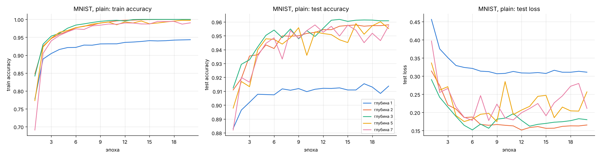
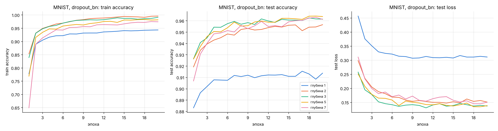
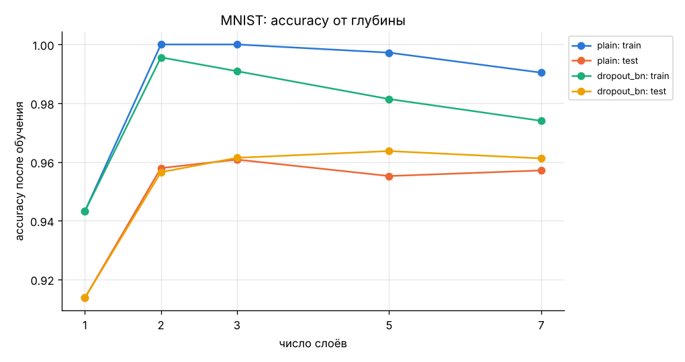

### CIFAR-10

| слоёв | параметров | train | test | разрыв | эпоха мин. test loss | время, с | D+BN train | D+BN test | D+BN разрыв | D+BN эпоха |
| --- | --- | --- | --- | --- | --- | --- | --- | --- | --- | --- |
| 1 | 30 730 | 48.0% | 33.1% | 14.9% | 4 | 5.1 | 48.0% | 33.1% | 14.9% | 4 |
| 2 | 789 258 | 90.6% | 42.2% | 48.4% | 4 | 11.6 | 67.2% | 46.8% | 20.4% | 13 |
| 3 | 855 050 | 96.0% | 45.6% | 50.4% | 3 | 12.5 | 66.1% | 48.1% | 18.0% | 10 |
| 5 | 986 634 | 90.8% | 42.8% | 48.1% | 4 | 15.1 | 60.0% | 48.2% | 11.8% | 17 |
| 7 | 1 118 218 | 86.5% | 43.8% | 42.6% | 4 | 16.9 | 56.1% | 47.3% | 8.8% | 15 |

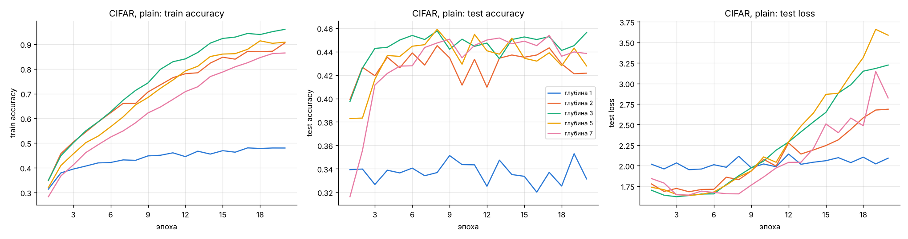
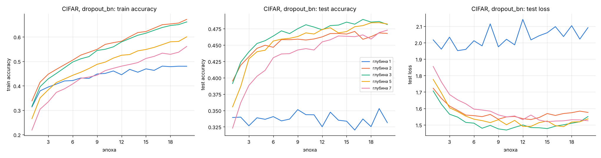
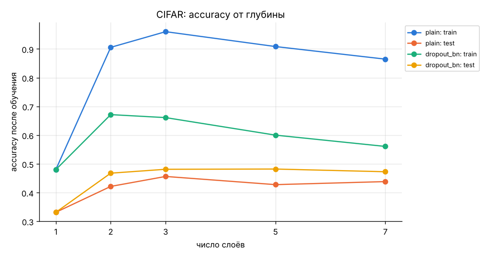

### Выводы

- **Линейный классификатор слишком простой.** На MNIST он даёт 91.4 %, на CIFAR 33.1 %, и даже train
  у него низкий: это недообучение. Уже один скрытый слой с ReLU даёт +4.4 п.п. на MNIST и +9 п.п. на CIFAR.
- **Оптимальная глубина без регуляризации — 3 слоя** на обоих датасетах (MNIST 96.1 %, CIFAR 45.6 %).
  5 и 7 слоёв не лучше, а учатся дольше: время растёт вместе с глубиной.
- **Переобучение.** На MNIST оно слабое: train доходит до 100 %, разрыв 3–4 п.п.
  На CIFAR сильное: train 86–96 %, test 42–46 %, разрыв 43–50 п.п., а test loss начинает расти
  уже на 3–4 эпохе. Дальше сеть просто запоминает обучающие картинки.
- **Dropout + BatchNorm.** На CIFAR test вырос на 2.5–5.4 п.п., разрыв упал с 43–50 до 9–20 п.п.,
  переобучение начинается намного позже (10–17 эпоха). Меньше всего разрыв у глубоких сетей
  (5 и 7 слоёв), и оптимум сдвигается к **5 слоям**: MNIST 96.4 %, CIFAR 48.2 % (у 3 слоёв 96.1 % и 48.1 %).
- CIFAR для полносвязной сети сильно сложнее MNIST: сеть не знает, какие пиксели соседние,
  и не может выучить формы объектов. Для картинок лучше свёрточные сети.

## Задание 2. Ширина сети

### 2.1 Четыре варианта ширины (3 скрытых слоя)

**MNIST**

| слои | параметров | train | test | разрыв | эпоха мин. test loss | время, с |
| --- | --- | --- | --- | --- | --- | --- |
| узкие [64, 32, 16] | 53 018 | 98.2% | 94.0% | 4.2% | 14 | 5.2 |
| средние [256, 128, 64] | 242 762 | 100.0% | 95.7% | 4.3% | 9 | 7.0 |
| широкие [1024, 512, 256] | 1 462 538 | 99.1% | 96.0% | 3.1% | 7 | 20.7 |
| очень широкие [2048, 1024, 512] | 4 235 786 | 98.8% | 95.7% | 3.1% | 8 | 60.8 |

**CIFAR-10**

| слои | параметров | train | test | разрыв | эпоха мин. test loss | время, с |
| --- | --- | --- | --- | --- | --- | --- |
| узкие [64, 32, 16] | 199 450 | 73.8% | 42.7% | 31.1% | 6 | 7.0 |
| средние [256, 128, 64] | 828 490 | 93.3% | 43.8% | 49.5% | 5 | 12.2 |
| широкие [1024, 512, 256] | 3 805 450 | 92.7% | 45.2% | 47.5% | 3 | 42.6 |
| очень широкие [2048, 1024, 512] | 8 921 610 | 88.3% | 44.4% | 43.9% | 5 | 104.5 |

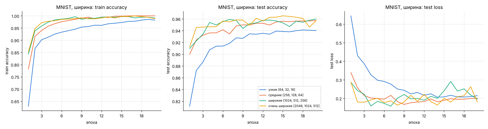
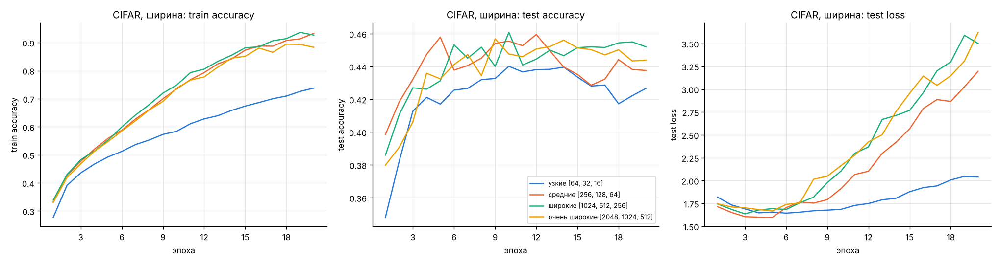

- **Параметры растут примерно как квадрат ширины.** От узких к очень широким: на MNIST в 80 раз
  (53 тыс. → 4.2 млн), на CIFAR в 45 раз (0.2 млн → 8.9 млн). Больше всего весов в первом слое:
  у CIFAR вход 3072 числа, и только первый слой очень широкой сети — 6.3 млн параметров из 8.9 млн.
- **Время растёт вслед за числом параметров:** очень широкая сеть учится в 10+ раз дольше узкой.
- **Точность растёт только до определённой ширины.** Лучше всех широкие [1024, 512, 256]
  (MNIST 96.0 %, CIFAR 45.2 %), очень широкие уже чуть хуже: лишние параметры идут на запоминание train.
  Узкие [64, 32, 16] заметно хуже: 16 нейронов — «бутылочное горлышко», через которое проходит мало информации.

### 2.2 Grid search: схема × базовая ширина

Перебраны 3 схемы × 5 базовых ширин w ∈ {64, 128, 256, 512, 1024} = 15 архитектур на каждом датасете:
расширение `[w/4, w/2, w]`, сужение `[w, w/2, w/4]`, постоянная `[w, w, w]`.

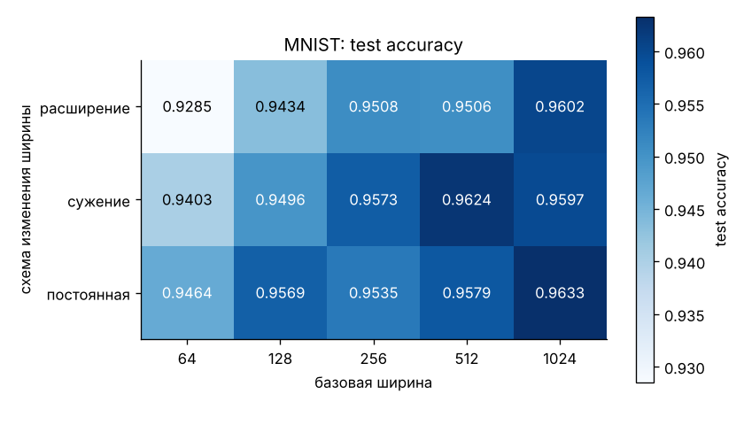
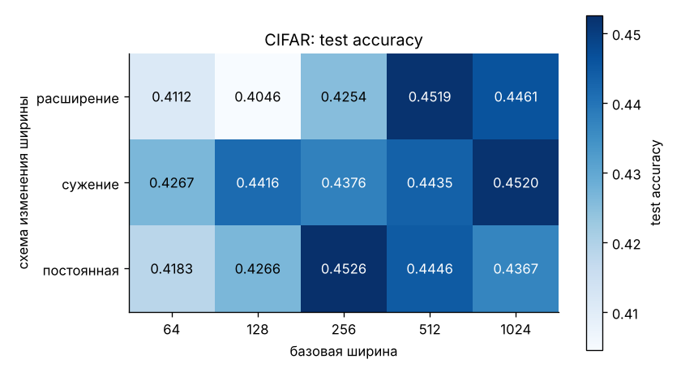

<details>
<summary>MNIST: все 15 архитектур (по убыванию test)</summary>

| архитектура | параметров | test | лучший test | время, с |
| --- | --- | --- | --- | --- |
| постоянная [1024, 1024, 1024] | 2 913 290 | 96.3% | 96.3% | 40.8 |
| сужение [512, 256, 128] | 567 434 | 96.2% | 96.3% | 11.1 |
| расширение [256, 512, 1024] | 868 106 | 96.0% | 96.0% | 14.9 |
| сужение [1024, 512, 256] | 1 462 538 | 96.0% | 96.0% | 21.2 |
| постоянная [512, 512, 512] | 932 362 | 95.8% | 96.0% | 15.3 |
| сужение [256, 128, 64] | 242 762 | 95.7% | 95.7% | 6.6 |
| постоянная [128, 128, 128] | 134 794 | 95.7% | 95.7% | 5.7 |
| постоянная [256, 256, 256] | 335 114 | 95.3% | 95.9% | 7.9 |
| расширение [64, 128, 256] | 94 154 | 95.1% | 95.1% | 6.2 |
| расширение [128, 256, 512] | 270 218 | 95.1% | 95.7% | 7.7 |
| сужение [128, 64, 32] | 111 146 | 95.0% | 95.0% | 5.3 |
| постоянная [64, 64, 64] | 59 210 | 94.6% | 94.7% | 5.4 |
| расширение [32, 64, 128] | 36 842 | 94.3% | 94.3% | 4.7 |
| сужение [64, 32, 16] | 53 018 | 94.0% | 94.1% | 4.4 |
| расширение [16, 32, 64] | 15 866 | 92.8% | 93.2% | 4.1 |

</details>

<details>
<summary>CIFAR-10: все 15 архитектур (по убыванию test)</summary>

| архитектура | параметров | test | лучший test | время, с |
| --- | --- | --- | --- | --- |
| постоянная [256, 256, 256] | 920 842 | 45.3% | 45.3% | 13.0 |
| сужение [1024, 512, 256] | 3 805 450 | 45.2% | 46.1% | 44.2 |
| расширение [128, 256, 512] | 563 082 | 45.2% | 45.2% | 10.9 |
| расширение [256, 512, 1024] | 1 453 834 | 44.6% | 46.2% | 21.2 |
| постоянная [512, 512, 512] | 2 103 818 | 44.5% | 45.4% | 25.2 |
| сужение [512, 256, 128] | 1 738 890 | 44.4% | 45.4% | 19.9 |
| сужение [128, 64, 32] | 404 010 | 44.2% | 44.9% | 8.4 |
| сужение [256, 128, 64] | 828 490 | 43.8% | 46.0% | 12.5 |
| постоянная [1024, 1024, 1024] | 5 256 202 | 43.7% | 45.4% | 65.8 |
| сужение [64, 32, 16] | 199 450 | 42.7% | 44.0% | 6.4 |
| постоянная [128, 128, 128] | 427 658 | 42.7% | 44.8% | 8.9 |
| расширение [64, 128, 256] | 240 586 | 42.5% | 44.5% | 8.2 |
| постоянная [64, 64, 64] | 205 642 | 41.8% | 44.7% | 7.2 |
| расширение [16, 32, 64] | 52 474 | 41.1% | 41.5% | 5.8 |
| расширение [32, 64, 128] | 110 058 | 40.5% | 43.2% | 6.0 |

</details>

- **MNIST:** лучшая — постоянная [1024, 1024, 1024] (96.3 %), но сужение [512, 256, 128] даёт 96.2 %
  при в 5 раз меньшем числе параметров и примерно в 4 раза быстрее. По соотношению «точность / цена» оптимум — она.
- **CIFAR:** лучшая — постоянная [256, 256, 256] (45.3 %), но первые места отличаются меньше чем на 1 п.п.,
  это в пределах случайного шума. Все модели сильно переобучаются, поэтому ширина больше 256 не помогает.
- **Схемы.** Расширение хуже всех при маленькой ширине: узкий первый слой (16–32 нейрона) сразу теряет
  информацию из сотен пикселей, и следующие широкие слои её уже не вернут. Сужение и постоянная близки.
  Сужение — разумный выбор по умолчанию: широкий первый слой извлекает много признаков, дальше они сжимаются.

## Задание 3. Регуляризация

Все варианты: CIFAR-10 (там переобучение сильнее, поэтому эффект виден лучше), одна архитектура
[512, 256, 128], одинаковый seed. В последнем столбце — стандартное отклонение весов
каждого линейного слоя (1-й, 2-й, 3-й, выходной).

### 3.1 Сравнение техник

| вариант | train | test | лучший test | разрыв | эпоха мин. test loss | разброс test, п.п. | std весов по слоям |
| --- | --- | --- | --- | --- | --- | --- | --- |
| без регуляризации | 94.0% | 44.4% | 45.4% | 49.7% | 4 | 0.35 | 0.0445, 0.0475, 0.0545, 0.0797 |
| Dropout 0.1 | 81.4% | 46.3% | 46.3% | 35.0% | 5 | 0.48 | 0.0442, 0.0480, 0.0536, 0.0688 |
| Dropout 0.3 | 60.4% | 46.3% | 47.0% | 14.1% | 9 | 0.45 | 0.0401, 0.0440, 0.0474, 0.0474 |
| Dropout 0.5 | 45.4% | 43.8% | 44.0% | 1.6% | 18 | 0.54 | 0.0346, 0.0406, 0.0439, 0.0340 |
| BatchNorm | 89.1% | 45.3% | 46.8% | 43.9% | 5 | 0.53 | 0.0399, 0.0486, 0.0532, 0.1429 |
| Dropout 0.3 + BatchNorm | 65.1% | 48.4% | 48.7% | 16.7% | 13 | 0.14 | 0.0386, 0.0463, 0.0517, 0.0928 |
| L2 (weight decay 0.001) | 79.6% | 43.8% | 46.1% | 35.7% | 5 | 0.99 | 0.0206, 0.0344, 0.0410, 0.0774 |

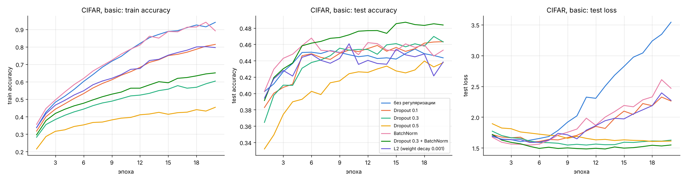
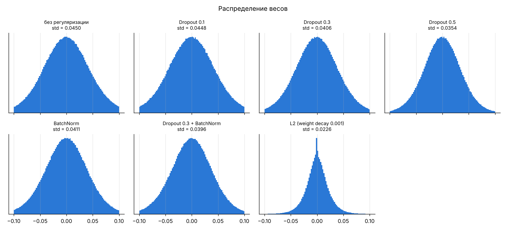

- **Без регуляризации** сеть переобучается: train 94 %, test 44.4 %, test loss растёт с 4-й эпохи
  (с 1.6 до 3.5 к концу).
- **Dropout:** чем больше коэффициент, тем меньше разрыв (35 → 14 → 1.6 п.п.). 0.1 и 0.3 дают
  по 46.3 %. 0.5 для 20 эпох уже слишком много: сеть недообучилась (train всего 45 %).
- **BatchNorm** ускоряет обучение (на первых эпохах test выше всех), но сам почти не мешает
  переобучению: разрыв 44 п.п.
- **Dropout 0.3 + BatchNorm — лучший вариант:** 48.4 % и самое стабильное обучение (разброс 0.14 п.п.).
  BatchNorm ускоряет обучение, Dropout не даёт запоминать train.
- **L2 (weight decay)** сильнее всех уменьшает веса: std весов 0.045 → 0.023, распределение узкое
  с пиком в нуле. Разрыв уменьшился до 36 п.п., но test accuracy скачет сильнее всех (разброс 0.99 п.п.).
- **Распределение весов.** Без регуляризации и с Dropout 0.1 распределение самое широкое (std 0.045).
  Dropout сужает его тем сильнее, чем больше коэффициент, L2 — сильнее всего.

### 3.2 Адаптивная регуляризация

| вариант | train | test | лучший test | разрыв | эпоха мин. test loss | разброс test, п.п. | std весов по слоям |
| --- | --- | --- | --- | --- | --- | --- | --- |
| без регуляризации | 94.0% | 44.4% | 45.4% | 49.7% | 4 | 0.35 | 0.0445, 0.0475, 0.0545, 0.0797 |
| Dropout 0.5 -> 0.1 | 68.4% | 45.7% | 46.3% | 22.7% | 11 | 0.50 | 0.0381, 0.0414, 0.0461, 0.0534 |
| BatchNorm momentum 0.01 | 89.1% | 45.2% | 46.3% | 43.9% | 5 | 0.28 | 0.0399, 0.0486, 0.0532, 0.1429 |
| BatchNorm momentum 0.1 | 89.1% | 45.3% | 46.8% | 43.9% | 5 | 0.53 | 0.0399, 0.0486, 0.0532, 0.1429 |
| BatchNorm momentum 0.9 | 89.1% | 41.6% | 45.1% | 47.5% | 4 | 0.86 | 0.0399, 0.0486, 0.0532, 0.1429 |
| BatchNorm + Dropout 0.5 -> 0.1 + L2 | 62.1% | 47.0% | 47.2% | 15.1% | 13 | 0.52 | 0.0172, 0.0301, 0.0355, 0.0975 |

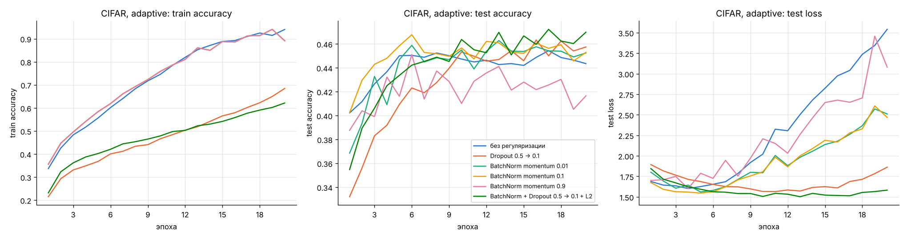

- **Dropout 0.5 → 0.1** (коэффициент линейно уменьшается по эпохам, `dropout_schedule`): 45.7 %.
  Это лучше постоянного 0.5 (43.8 %): в начале сильная защита от запоминания, в конце сеть может доучиться.
  Но постоянный 0.3 на этой задаче всё равно чуть лучше.
- **BatchNorm momentum.** Train у всех трёх вариантов одинаковый до последней цифры: momentum не влияет
  на обучение, он влияет только на скользящие среднее и дисперсию, которые BatchNorm использует на тесте.
  0.01 и 0.1 дают 45.2–45.3 %. При 0.9 статистика почти целиком берётся из последнего батча,
  поэтому она шумная: test 41.6 % и самый большой разброс.
- **Комбинация** BatchNorm + Dropout 0.5 → 0.1 + L2: 47.0 %, разрыв 15 п.п. Лучше каждой техники
  по отдельности, но чуть хуже простого Dropout 0.3 + BatchNorm.

### 3.2 Влияние на разные слои

| вариант | train | test | лучший test | разрыв | эпоха мин. test loss | разброс test, п.п. | std весов по слоям |
| --- | --- | --- | --- | --- | --- | --- | --- |
| без регуляризации | 94.0% | 44.4% | 45.4% | 49.7% | 4 | 0.35 | 0.0445, 0.0475, 0.0545, 0.0797 |
| Dropout 0.5 во всех слоях | 45.4% | 43.8% | 44.0% | 1.6% | 18 | 0.54 | 0.0346, 0.0406, 0.0439, 0.0340 |
| Dropout 0.5 только в 1-м | 64.1% | 47.1% | 47.1% | 17.1% | 10 | 0.48 | 0.0409, 0.0460, 0.0494, 0.0555 |
| Dropout 0.5 только в 3-м | 81.3% | 45.4% | 46.8% | 35.9% | 6 | 0.54 | 0.0440, 0.0448, 0.0505, 0.0712 |
| BatchNorm во всех слоях | 89.1% | 45.3% | 46.8% | 43.9% | 5 | 0.53 | 0.0399, 0.0486, 0.0532, 0.1429 |
| BatchNorm только в 1-м | 87.1% | 47.1% | 47.1% | 40.0% | 5 | 1.11 | 0.0473, 0.0557, 0.0649, 0.0961 |
| BatchNorm только в 3-м | 95.6% | 45.6% | 46.9% | 50.0% | 5 | 0.45 | 0.0398, 0.0484, 0.0521, 0.1461 |

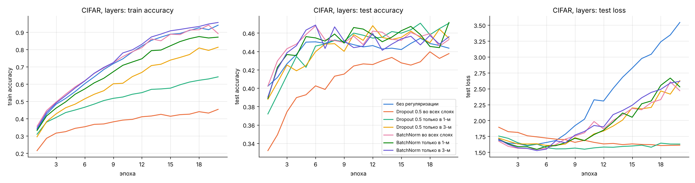

- **Dropout только в 1-м слое** (47.1 %) лучше, чем во всех слоях (43.8 %) и чем только в 3-м (45.4 %).
  Причина: в первом слое 3072 × 512 ≈ 1.57 млн весов из 1.74 млн, то есть 90 % всей сети.
  Запоминание происходит в основном там, и регуляризация нужна именно там.
- **BatchNorm только в 1-м слое** на последней эпохе тоже дал 47.1 %, но это скорее удачная эпоха:
  test loss растёт так же, как без регуляризации, а разброс самый большой (1.11 п.п.).
  BatchNorm только в 3-м почти ничего не меняет (разрыв 50 п.п., как без регуляризации).
  BatchNorm в любом месте сам по себе от переобучения не спасает, а Dropout в первом слое — спасает:
  его test loss почти не растёт.

## Итог

| Вопрос | Ответ |
| --- | --- |
| Оптимальная глубина | 3 слоя без регуляризации, 5 слоёв с Dropout + BatchNorm |
| Оптимальная ширина | MNIST — [512, 256, 128] (почти лучший результат, в 5 раз дешевле лучшего), CIFAR — около 256 нейронов, шире не помогает |
| Лучшая регуляризация | Dropout 0.3 + BatchNorm: +4 п.п. на CIFAR и самое стабильное обучение |
| Где регуляризация важнее всего | в первом слое, где больше всего параметров |

## Тесты

`python test_experiments.py` — 9 тестов на простых примерах: число слоёв для каждой глубины,
размер выхода, подсчёт параметров на сети 4 → 3 → 2, расстановка Dropout и BatchNorm по слоям,
`set_dropout`, обучение на простой задаче (две точки по разные стороны прямой, accuracy > 95 %),
weight decay уменьшает веса, расписание Dropout доходит до 0.1, подсчёт эпохи переобучения и разрыва.
